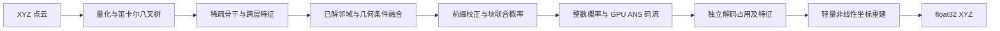

# LatticeLiDAR

**基于笛卡尔八叉树、因果概率建模与特征驱动重建的 LiDAR 几何压缩。**

这是 2026-10-16 导师汇报所用最终模型的独立推理仓库，包含模型代码、完整权重、四个量化尺度配置和编解码命令。仓库名称于打包时确定，不代表新增模型或重新训练。当前为研究用私有发布，版本 `0.1.0`。

## 技术路线



- **可实际解码的联合概率建模**：融合已解空间条件和层级特征，以前缀校正和块共享离散隐变量利用符号相关性；通过有限精度 GPU 熵编码形成包含封装开销的实际码流。
- **解码特征驱动的坐标重建**：复用父节点 32 维特征与 8 位已解占用，在仿射坐标预测上增加 64 隐藏通道的 GELU 残差，偏移限制在半个量化格内。重建只依赖解码产物，不向概率模型反馈原始点，不增加占用码流；权重由两端预先共享。
- **执行与显存优化**：采用 CUDA Graph、算子融合、几何输入复用及概率表生命周期管理。编码端采用冻结的 `baseline` 策略，解码端采用 `combined` 策略；这些名字属于同一最终实现内部的执行选择。

稀疏专家骨干和跨层传播继承自 ELiC，整数概率约定沿用 RENO。有限混合、bits-back、ANS 和 GELU 都是已有方法，贡献在于本系统的组合、领域适配及实际验证，详见 [来源与许可](THIRD_PARTY.md)。

## 环境与安装

已验证的原始运行环境为 **Linux、NVIDIA RTX 4090、Python 3.10、PyTorch 2.2.1 + CUDA 11.8**。需要 NVIDIA 驱动、CUDA Toolkit 11.8（含 `nvcc`）及兼容的 C++ 编译器；只有 PyTorch 自带 CUDA 运行库还不够。Windows 可保存和检查仓库，本版本的 Triton/GPU 编解码面向 Linux。

```bash
git clone https://github.com/TheLeft805/LatticeLiDAR.git
cd LatticeLiDAR
python3.10 -m venv .venv
source .venv/bin/activate
python -m pip install -r requirements.txt
export CUDA_HOME=/usr/local/cuda-11.8
export PATH="$CUDA_HOME/bin:$PATH"
python tools/verify_assets.py
```

首次运行会编译 CUDA 扩展及 Triton 内核，初始化明显慢于后续帧。固定容量配置来自本次 KITTI 验收；超出容量的新点云不能直接继承该验收结果。数值环境、源码、配置和权重均参与码流身份校验，两端必须匹配。

## 编码与解码

输入坐标单位为米：支持 KITTI `.bin`（每点四个 float32，只编码 XYZ），或 `.npy`（`N×3` 数组）。输出为重建后的 `.ply` 或 `.npy`，坐标同样以米为单位。

```bash
# 单帧；8、16、32、64 mm 均支持，默认 16 mm。
python encode.py --input data/000000.bin --output outputs/frame.lgr --quantization-mm 16
python decode.py --input outputs/frame.lgr --output outputs/frame.ply --quantization-mm 16

# 完整目录：读取按名称排序的 *.bin，文件名须为数字帧号。
python encode.py --input data/11/velodyne --output outputs/seq11.lsq --sequence 11 --quantization-mm 8
python decode.py --input outputs/seq11.lsq --output outputs/seq11 --sequence 11 --quantization-mm 8
```

解码仅需要码流、共享权重及相同参数，不读取原始点云。已有输出不会被覆盖。序列解码按帧输出，若后续帧损坏，已输出的前序帧会保留；编码失败可能留下 `.partial` 文件，排查后再重试。

这是**有损几何压缩**：不编码反射强度、原始点顺序和重合点的重复次数。最终坐标由学习重建头产生，不能把输出解释为原始点云的无损恢复。当前仓库只提供推理，未打包训练数据、训练流水线或优化器状态。

## 已有验收结果

数据为 KITTI 序列 11–21 全局排序每 20 帧取 1 帧，每个量化点 **1,018 帧**，四尺度共 **4,072 份实际解码点云**。以下为原验收结果，不是本次打包重新测得。

| 量化步长 | 实际 bpp | D1 PSNR (dB) | D2 PSNR (dB) | 编码均值 (ms) | 解码均值 (ms) |
|---|---:|---:|---:|---:|---:|
| 8 mm | 7.8502 | 89.4128 | 94.7282 | 77.15 | 72.81 |
| 16 mm | 5.6839 | 83.6400 | 89.1926 | 61.63 | 57.36 |
| 32 mm | 3.7643 | 77.5502 | 83.1485 | 49.49 | 44.46 |
| 64 mm | 2.1938 | 71.2609 | 76.9324 | 41.01 | 35.20 |

共同区间内，相对 G-PCC 的 D1/D2 BD-BR 为 **−38.72% / −42.16%**，相对 ELiCv1 为 **−18.01% / −22.58%**。负值表示在对应质量区间内节省码率。

计时从 CPU XYZ 到完整 CPU 码流，独立解码到可用 CPU float32 XYZ；包含必要拷贝和封装，排除磁盘、初始化、编译、预热及指标计算。原验收是单轮固定顺序计时，尚不支持重复性、连续输入实时性或严格未见测试集的强主张。完整口径与尾延迟见 [验证说明](docs/VALIDATION.md)。

## 文件与权重

| 路径 | 内容 |
|---|---|
| `encode.py` / `decode.py` | 最终模型的命令行入口 |
| `model_config.py` | 固定重建头、四尺度配置与执行策略绑定 |
| `lidar_codec/` | 冻结的概率模型、熵编码、稀疏计算和 CUDA/Triton 实现 |
| `reconstruction_codec.py` / `residual_head.py` | 冻结的特征重建实现 |
| `weights/backbone.pt` | 主模型及预共享概率/几何表，9,035,391 字节 |
| `weights/reconstruction.npz` | 原始重建权重资产，275,660 字节 |
| `configs/q*.json` | 8/16/32/64 mm 对应的固定容量配置 |
| `ASSETS.json` | 冻结文件 SHA-256 与版本身份 |

保留原重建资产和实现的字节内容，以维持既有码流身份；其中的历史分支不作为本仓库的模型选项，入口只选择最终 `gelu64`。请勿对冻结核心源码自动改换行或批量格式化，否则身份会变化。

```bash
# CPU 检查，不需要安装 CUDA 或 torch。
python -m pip install numpy==1.26.4
python tools/verify_assets.py
python -m unittest discover -s tests -v
```

许可证见 [LICENSE](LICENSE)；继承的模型部分和原生算子同时受各自第三方许可约束，见 [THIRD_PARTY.md](THIRD_PARTY.md)。
